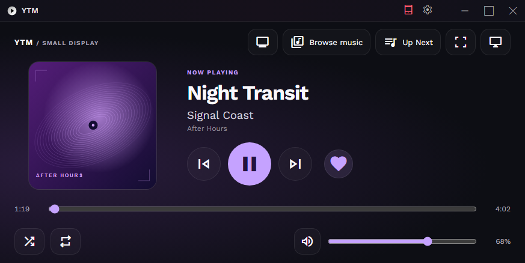

# YTM Desktop

An independent, open-source YouTube Music desktop app for Windows, macOS, and Linux, with a touch-friendly player for small displays and integrations for your desktop setup.

[Downloads](https://github.com/Lostepic/ytmdesktop/releases/latest) · [Screenshots](docs/SHOWCASE.md) · [User guide](docs/USER-GUIDE.md) · [Changelog](docs/CHANGELOG.md) · [Development](docs/DEVELOPMENT.md)

## Install

Get the installer for your platform from [GitHub Releases](https://github.com/Lostepic/ytmdesktop/releases/latest).

| Platform | Download |
| --- | --- |
| Windows x64 | `Setup.exe` |
| macOS | `darwin-arm64` ZIP for Apple Silicon; `darwin-x64` ZIP for Intel |
| Linux x64 | `.deb` for Debian/Ubuntu; `.rpm` for Fedora/RHEL |

## Highlights

- **[Small Display mode](docs/SHOWCASE.md#small-display-mode):** Touch-friendly browsing, search, playback, and queue controls for compact screens. Works with an Echo Show 5 used as a Windows display through spacedesk.
- **[Playback and sound](docs/SHOWCASE.md#playback-and-sound):** Ten-band EQ with presets, resume-on-launch, global shortcuts, and built-in themes. YouTube Music still sets the source stream quality.
- **[Plugins and devices](docs/SHOWCASE.md#plugins-and-devices):** Stream Deck support, local now-playing export for OBS, Discord Rich Presence, Last.fm, ListenBrainz, and optional SponsorBlock.

## License and credits

The app source is open source under [GPL-3.0-only](LICENSE). It incorporates work by the [original YouTube Music Desktop App project](https://github.com/ytmdesktop/ytmdesktop) and its contributors.

This is not an official Google, YouTube, Amazon, spacedesk, or Elgato product. YouTube Music is a separate hosted service; its software and content are not licensed by this repository.
