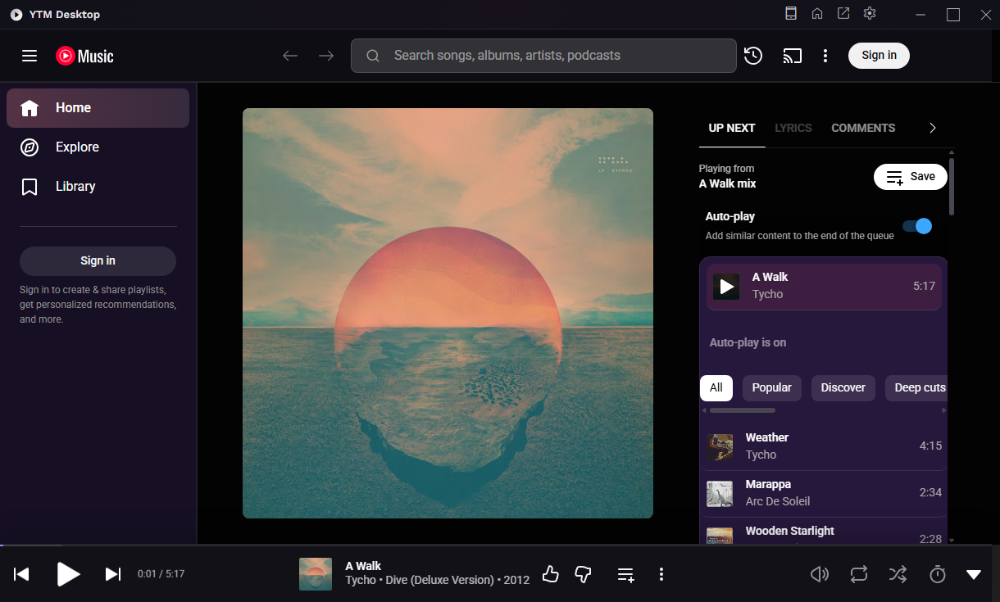
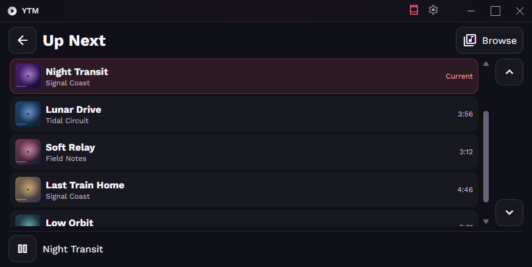
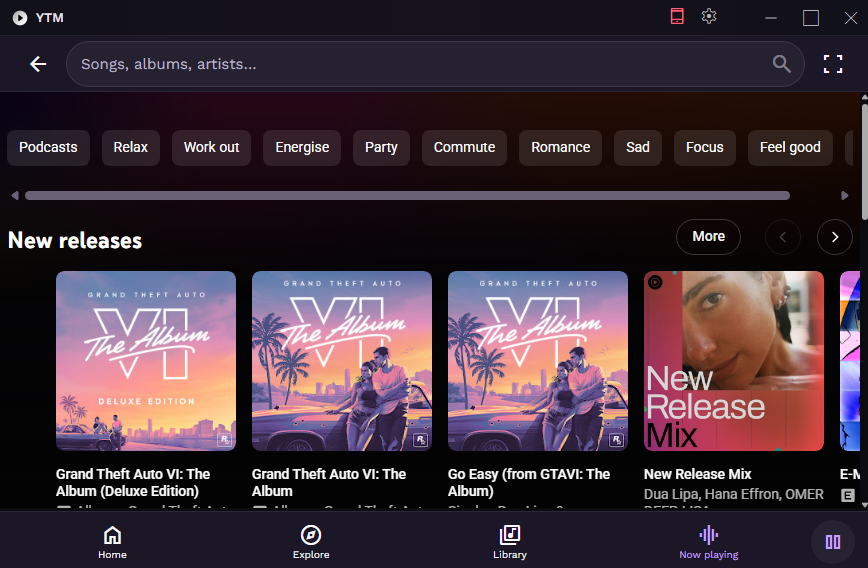
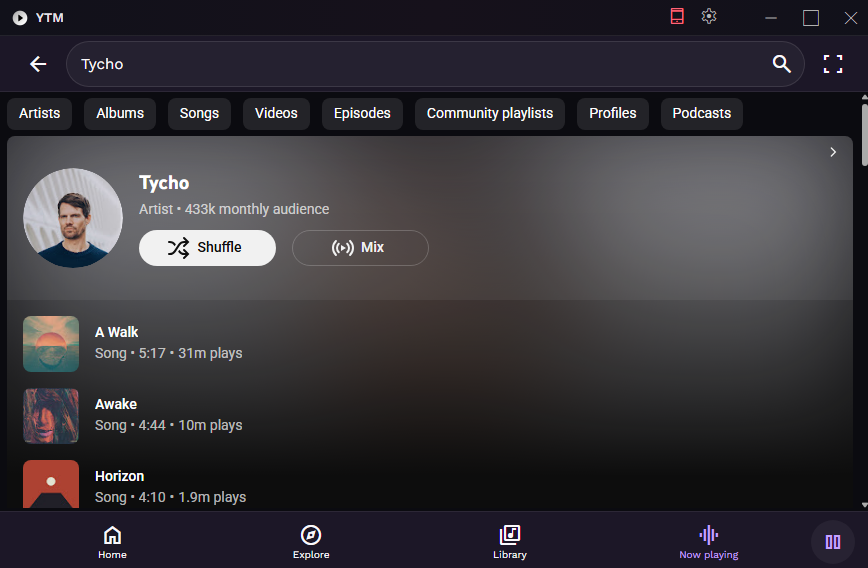
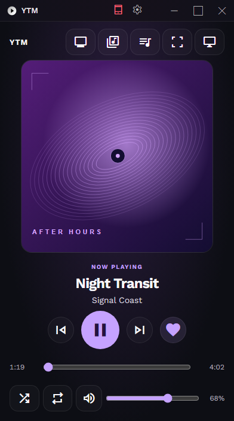

# YTM Desktop

An independent, open-source YouTube Music desktop app for Windows, macOS, and Linux. Use the full desktop player at your desk, or switch to a touch-friendly layout for a tablet or a small second screen.

[Downloads](https://github.com/Lostepic/ytmdesktop/releases/latest) · [Screenshots](#screenshots) · [User guide](docs/USER-GUIDE.md) · [Changelog](docs/CHANGELOG.md) · [Development](docs/DEVELOPMENT.md)

## Screenshots

### Desktop player

### Small Display mode

| Now Playing | Up Next |
| --- | --- |
|  |  |

| Browse | Search |
| --- | --- |
|  |  |

More screenshots: portrait layout, equalizer, and integrations

| Portrait player | Ten-band EQ | Integrations |
| --- | --- | --- |
|  |  |  |

[View the full-size gallery with captions](docs/SHOWCASE.md).

## Install

Get the installer for your platform from [GitHub Releases](https://github.com/Lostepic/ytmdesktop/releases/latest).

| Platform | Download |
| --- | --- |
| Windows x64 | `Setup.exe` |
| macOS | `darwin-arm64` ZIP for Apple Silicon; `darwin-x64` ZIP for Intel |
| Linux x64 | `.deb` for Debian/Ubuntu; `.rpm` for Fedora/RHEL |

See the [installation and update guide](docs/USER-GUIDE.md#downloads-and-updates) for platform-specific steps and signing notes.

## What you can do

- **Make the player your own.** Choose a built-in theme, use the compact mini-player, control playback with global shortcuts, or pick up where you left off when you launch the app.
- **Use a smaller screen.** Small Display mode gives you large playback controls, swipeable browsing, search, and an Up Next queue that opens at the current track. Now Playing adapts to portrait and landscape.
- **Tune the sound.** The optional ten-band EQ has presets, a preamp, and automatic headroom. It changes the tone, not the quality of the stream supplied by YouTube Music.
- **Connect your desktop tools.** Pair a compatible Stream Deck connector, export now-playing data locally for OBS, or enable Discord Rich Presence, Last.fm, ListenBrainz, or SponsorBlock. Optional performance telemetry stays on your device.

## Quick setup

- **Echo Show 5:** Connect it as a Windows display with spacedesk first. Turn on Small Display mode with the tablet button, then choose the Show using the monitor button in Now Playing. [Small Display setup](docs/USER-GUIDE.md#echo-show-5-and-small-displays).
- **Stream Deck:** In **Settings → Integrations**, enable the companion server and pairing. Select **Authorize** in your connector, then approve the request in YTM Desktop. [Integration setup](docs/USER-GUIDE.md#audio-and-integrations).

## License and credits

The app source is open source under [GPL-3.0-only](LICENSE). It incorporates work by the [original YouTube Music Desktop App project](https://github.com/ytmdesktop/ytmdesktop) and its contributors.

This is not an official Google, YouTube, Amazon, spacedesk, or Elgato product. YouTube Music is a separate hosted service; its software and content are not licensed by this repository.
