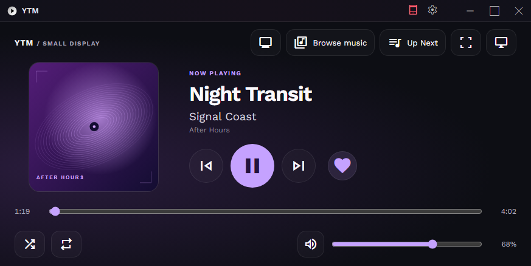
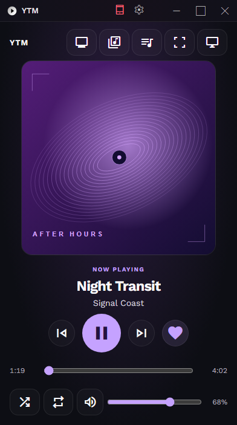
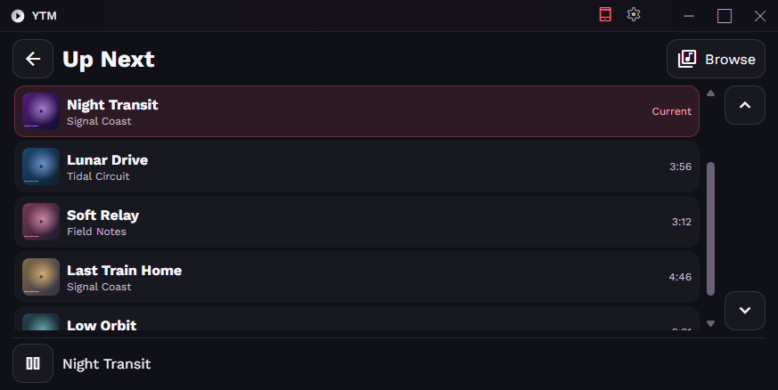
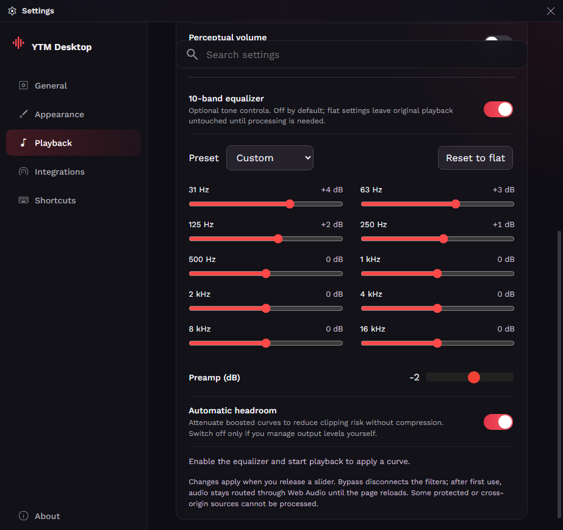
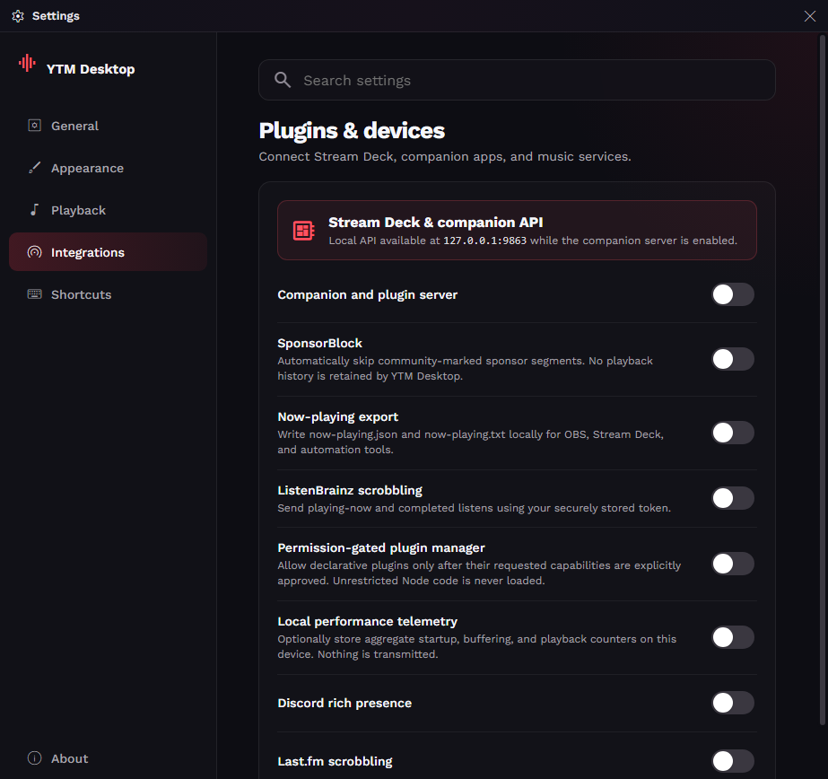

# YTM Desktop screenshots

[Project home](../README.md) · [Downloads](https://github.com/Lostepic/ytmdesktop/releases/latest) · [User guide](USER-GUIDE.md)

These captures show the app with sample tracks and artwork.

## Small Display mode

Now Playing keeps the artwork and transport controls side by side in landscape and stacks them in portrait. Use **Browse music** to switch to the touch-friendly browsing and search layout.

### Up Next

The queue opens at the current track. Tap a track to play it, or use the arrow buttons to move through the list without dragging the scrollbar.

## Playback and sound

The optional ten-band equalizer has presets, a preamp, and automatic headroom to reduce clipping risk when boosting frequencies. It shapes the sound without changing YouTube Music’s source bitrate.

## Plugins and devices

The Integrations panel brings together Stream Deck pairing, local now-playing export, scrobbling, Discord Rich Presence, and the permission-gated plugin manager. See the [setup instructions](USER-GUIDE.md#audio-and-integrations) to connect your devices.

